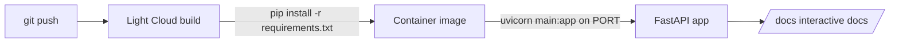

# tutorial-fastapi-api

[](https://console.light-cloud.com/new?repo=https://github.com/light-cloud-com/tutorial-fastapi-api)

A small FastAPI app used in the Light Cloud tutorial
[FastAPI in production: from main.py to a public URL](https://blog.light-cloud.com/tutorials/deploy-a-fastapi-app).

Light Cloud finds `main.py` and `requirements.txt`, installs the requirements and starts
`uvicorn main:app` on the port it gives the container. No Dockerfile needed.



## Run it

```sh
python3 -m venv .venv
. .venv/bin/activate
pip install -r requirements.txt
fastapi dev main.py
```

Then open http://127.0.0.1:8000/docs.

| Route | What it does |
|---|---|
| `GET /` | greeting |
| `GET /health` | `{"status":"ok"}` |
| `GET /books` | list books (in memory) |
| `POST /books` | add a book; validated by Pydantic |
| `GET /books/{id}` | one book, or 404 |
